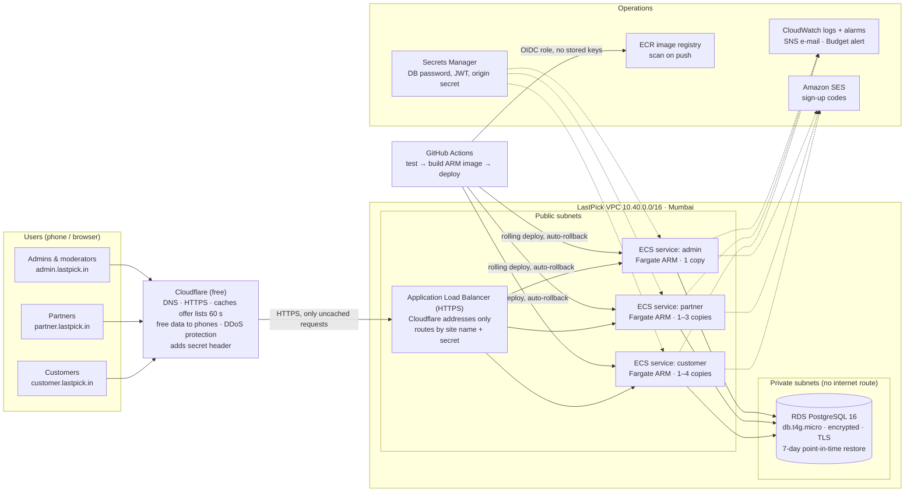

# lastpick-terraform

AWS infrastructure for **LastPick**: ECS Fargate + RDS PostgreSQL in Mumbai (`ap-south-1`), in its own VPC (`10.40.0.0/16`), with **Cloudflare (free plan)** in front for DNS, HTTPS and caching.
The application code (server, web apps, Dockerfile, deploy workflow) lives in [prudhvisuryalastpick/lastpick](https://github.com/prudhvisuryalastpick/lastpick).

## Tech stack

| Layer | Technology |
|---|---|
| Web apps (customer, partner, admin) | React 18 + Vite, served by each service's container (compressed, cached a year) |
| API | Node.js 22 (one codebase, `SERVICE=customer\|partner\|admin`), only package `pg`; replies brotli/gzip-compressed |
| Edge | Cloudflare free plan: DNS, HTTPS (Full strict), cache rule for `/api/offers`, redirect lastpick.in/www → customer site |
| Load balancer | Public ALB, HTTPS with a free AWS certificate, reachable only from Cloudflare's address ranges + secret header |
| Containers | Docker image (Alpine, non-root, ARM/Graviton) on ECS Fargate, Fargate Spot for extra copies |
| Database | Amazon RDS PostgreSQL 16 (read replica optional), Postgres job queue (`SKIP LOCKED`) |
| Secrets | AWS Secrets Manager, injected by ECS |
| Monitoring | CloudWatch logs (errors and slow requests only) and alarms, RDS events, SNS e-mail, AWS Budgets |
| Infrastructure as code | Terraform (this repo), run by GitHub Actions |

## Files

| File | What it creates |
|---|---|
| `network.tf` | VPC, 2 public subnets (load balancer, containers), 2 private subnets (database), security groups |
| `alb.tf` | Public load balancer (Cloudflare only), HTTPS listener, routing by site name + secret header |
| `domain.tf` | AWS certificate, all Cloudflare DNS records, redirect, secret-header and cache rules, HTTPS settings |
| `ecs.tf` | ECR, ECS cluster, 3 services, task definitions, CPU auto scaling |
| `data.tf` | RDS database (+ optional read replica), parameter group, Secrets Manager, AWS Backup |
| `email.tf` | Amazon SES domain identity and send permission |
| `operations.tf` | Alarms, budget alert, GitHub deploy role, `/lastpick/deploy` settings |
| `cdn.tf` | CloudFront (not used; `use_cloudfront = false`) |

## One-time Cloudflare setup (owner, in the browser, ~15 minutes)

1. Sign up at cloudflare.com (free) → **Add a site** → `lastpick.in` → **Free** plan.
2. Cloudflare copies your existing DNS records. **Check the MX and TXT records for your support@lastpick.in mailbox are in the list** (they keep your GoDaddy e-mail working).
3. Cloudflare shows 2 nameservers. At GoDaddy: My Products → lastpick.in → DNS → **Nameservers → Change → "I'll use my own nameservers"** → paste both → Save. Cloudflare e-mails you when the site is active (usually within an hour).
4. Cloudflare → My Profile → **API Tokens → Create Token → "Edit zone DNS" template**, then add these permissions: *Zone · Zone Settings · Edit*, *Zone · Config Rules / Dynamic Redirect · Edit*, *Zone · Transform Rules · Edit*, *Zone · Cache Rules · Edit*. Zone resources: *Include · Specific zone · lastpick.in*. Create, then copy the token.
5. GitHub → lastpick-terraform → Settings → Secrets and variables → Actions → **New repository secret** `CLOUDFLARE_API_TOKEN` = the token. Never paste it in a chat.

After this, every DNS record is created by Terraform. Nothing is added at GoDaddy again.

## Create / destroy (GitHub Actions → Infrastructure)

- `plan` → check → `apply` with confirm `yes` (about 20 minutes; the certificate is issued in the same run).
- Then lastpick repo → Actions → Deploy to AWS (tick *test accounts*). Sites: https://customer.lastpick.in, https://partner.lastpick.in, https://admin.lastpick.in.
- `destroy` with confirm `destroy` removes everything, Cloudflare records included (the Cloudflare site itself stays).
- `diagnose` shows the certificate, SES and container status.

## Monthly cost (estimate, Mumbai)

- Low traffic: about **₹7,000–8,500 a month** incl. GST (load balancer, 3 small containers, small database). Billed by the hour; destroy after testing.
- 10,000 people online at once: about **₹40,000–50,000 a month**, because Cloudflare serves cached offer lists and the data to phones for free, and replies are compressed. Without Cloudflare it would be about ₹5 lakh.

## AI agent

`.claude/agents/infra.md`: a Claude Code agent for creating, changing, checking and destroying this infrastructure. It always shows the plan and asks before `apply` or `destroy`.
