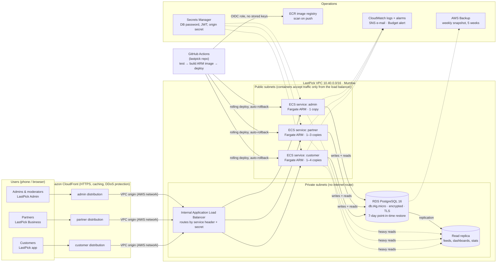

# lastpick-terraform

AWS infrastructure for **LastPick**: ECS Fargate + RDS PostgreSQL in Mumbai (`ap-south-1`), in its own VPC (`10.40.0.0/16`).
The application code (server, web apps, Dockerfile, deploy workflow) lives in [prudhvisuryalastpick/lastpick](https://github.com/prudhvisuryalastpick/lastpick).

## Tech stack



| Layer | Technology |
|---|---|
| Web apps (customer, partner, admin) | React 18 + Vite, served by each service's container |
| API | Node.js 22 (one codebase, `SERVICE=customer\|partner\|admin`), only package `pg` |
| Containers | Docker image (Alpine, non-root, ARM/Graviton) on ECS Fargate, Fargate Spot for extra copies |
| Database | Amazon RDS PostgreSQL 16 + read replica, Postgres job queue (`SKIP LOCKED`) |
| Edge | Amazon CloudFront (3 distributions) with VPC origins to an internal ALB |
| Secrets | AWS Secrets Manager, injected by ECS |
| Monitoring | CloudWatch logs and alarms, RDS events, SNS e-mail, AWS Budgets |
| Backups | RDS automated backups (7 days PITR) + AWS Backup weekly |
| Infrastructure as code | Terraform (this repo) |
| CI/CD | GitHub Actions with OIDC (app repo), weekly security rebuild |

## Files

| File | What it creates |
|---|---|
| `network.tf` | VPC, 2 public subnets (containers), 2 private subnets (load balancer, database), security groups |
| `ecs.tf` | ECR, ECS cluster, 3 services (customer, partner, admin), task definitions, CPU auto scaling |
| `alb.tf` | Internal load balancer, target groups, header-based routing |
| `cdn.tf` | CloudFront VPC origin and 3 distributions |
| `data.tf` | RDS main database + read replica, parameter group, Secrets Manager, AWS Backup |
| `operations.tf` | Alarms, RDS event e-mails, budget alert, GitHub deploy role, `/lastpick/deploy` settings |

## Create it (AWS CloudShell, region Mumbai, ~20 minutes)

```bash
sudo dnf install -y dnf-plugins-core && sudo dnf config-manager --add-repo https://rpm.releases.hashicorp.com/AmazonLinux/hashicorp.repo && sudo dnf install -y terraform
git clone https://github.com/prudhvisuryalastpick/lastpick-terraform && cd lastpick-terraform
cp terraform.tfvars.example terraform.tfvars    # put your e-mail; protect_data = false for a test setup you'll delete
terraform init
terraform plan
terraform apply
terraform output
```

Then:
1. Confirm the alarm and budget e-mails from AWS.
2. In the **lastpick** repo: Settings → Secrets and variables → Actions → Variables → `AWS_DEPLOY_ROLE_ARN` = `terraform output -raw deploy_role_arn`.
3. In the **lastpick** repo: Actions → Deploy to AWS → Run workflow (tick *test accounts*). Until this first run the services have no image and keep retrying; that's expected.
4. Test account password: Secrets Manager → `lastpick/test-accounts`. Site addresses: `terraform output`.

## Terminate everything (after testing)

```bash
# 1. if you created it with protect_data = true, switch protection off first:
sed -i 's/^protect_data.*/protect_data = false/' terraform.tfvars && terraform apply
# 2. remove everything (database, images, logs, CloudFront, VPC):
terraform destroy
```

CloudFront distributions take about 15 minutes to disable before they are deleted; `terraform destroy` waits for that. Check the bill afterwards: Billing → Bills should show nothing new the next day.

## Monthly cost (estimate, Mumbai, $1 = ₹94.85)

≈ $93.5 ≈ ₹8,860 + 18% GST ≈ **₹10,460** with the read replica; ≈ ₹8,430 incl. GST without it (`db_read_replica = false`). Testing for a few days costs a few hundred rupees (everything is billed by the hour), as long as you destroy it afterwards.

## Keep the state safe (for a long-lived setup)

```bash
aws s3 mb s3://lastpick-terraform-state-$(aws sts get-caller-identity --query Account --output text) --region ap-south-1
# uncomment the backend "s3" block in versions.tf (put your account id in the bucket name), then:
terraform init -migrate-state
```

For a short test that you destroy from the same CloudShell, the local state is fine. Don't delete the CloudShell home folder before `terraform destroy`.

## AI agent

`.claude/agents/infra.md`: a Claude Code agent for creating, changing, checking and destroying this infrastructure. It always shows the plan and asks before `apply` or `destroy`.
